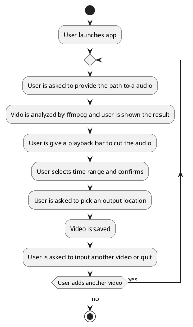

---
tags:
- Go
- Projects
MOC: Personal
---
[[_0000 Home|Home]] | [[_0003 Personal MOC]] | [[PER Project ideas index|Back to index]]
# Flowchart

# Progress
- [x] Add file picker
- [ ] Add time range bar
- [ ] Add input and output file values
- [ ] Check Lipgloss