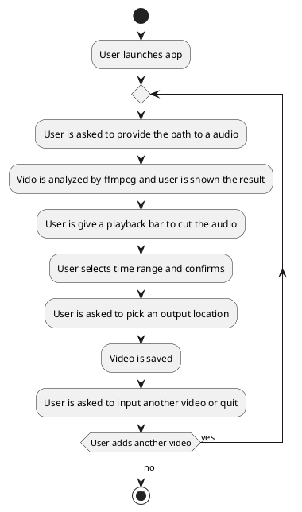

---
tags:
- Go
- Projects
MOC: Personal
---
[[_0000 Home|Home]] | [[_0003 Personal MOC]] | [[PER Project ideas index|Back to index]]
# Plan
## Goals
- [ ] Learn bubbletea
- [ ] Build a media cutter tool
- [ ] Learn ffmpeg some more
- [ ] Learn more about media files
# Phases
## Phase 1 - Functional app
- [x] Add file picker
	- [x] Add input file input
	- [ ] Add output file input
- [ ] Request cut start time
- [ ] Request cut end time
## Phase 2 - Prettier
- [ ] Add time range bar
- [ ] Check Lipgloss
## Phase 3 - Higher convenience
- [ ] Add ability to play audio
- [ ] Add ability to play video
- [ ] Add final cut preview
- [ ] Add ability to listen to/see the audio/video as we cut
# Design Flowchart

